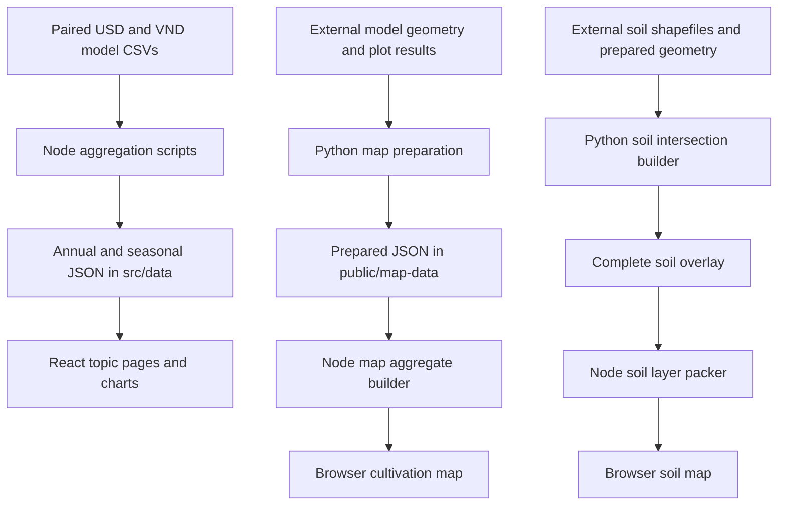

# STAR-FARM Dashboard — Developer Handbook

This handbook is the single onboarding and maintenance guide for the **Dashboard** application. It explains how to run the project, understand its results, find the relevant code, make changes, and prepare a release. It consolidates the former user, data, maintenance, deployment, map, seasonal, and asset guides.

**Reviewed against the local source on November 10, 2026.** The guide includes the map and soil features present in this working tree; this date does not imply that every feature has been deployed. Dataset counts describe the checked-in inputs and must be reviewed when those inputs change.

## Contents

- [1. Understand the project](#1-understand-the-project)
- [2. Run it locally](#2-run-it-locally)
- [3. Application architecture and code map](#3-application-architecture-and-code-map)
- [4. Pages, navigation, and user workflows](#4-pages-navigation-and-user-workflows)
- [5. Data sources and generation](#5-data-sources-and-generation)
- [6. Calculations, units, and interpretation](#6-calculations-units-and-interpretation)
- [7. Seasonal analysis](#7-seasonal-analysis)
- [8. Cultivation map](#8-cultivation-map)
- [9. Soil and flood map](#9-soil-and-flood-map)
- [10. Making changes](#10-making-changes)
- [11. Visual design and assets](#11-visual-design-and-assets)
- [12. Testing and verification](#12-testing-and-verification)
- [13. Build and deployment](#13-build-and-deployment)
- [14. Troubleshooting](#14-troubleshooting)
- [15. Handoff and documentation maintenance](#15-handoff-and-documentation-maintenance)

## 1. Understand the project

STAR-FARM Dashboard is a bilingual Vietnamese–English website for exploring modeled rice-farming scenarios in Dong Thap, Vietnam. Users compare income, production costs, yield, labor, resource use, and methane emissions across farming systems and future conditions for **2027–2050**. Current-condition records for **2016–2022** provide a reference on the pages that explicitly use that baseline.

The application is a **static React website**. Node scripts prepare data before development and production builds. The browser renders those prepared datasets using React, Recharts, and a local SVG map; it does not run a machine-learning model or a simulation. Map pages fetch JSON files from the same website.

### Scope within this repository

| Directory | Responsibility |
| --- | --- |
| `Dashboard/` | This static scenario and map dashboard; all commands in this handbook run here unless stated otherwise |
| `../Web App/` | A separate simulation application with its own frontend and backend configuration |
| `../Data Studio guide/` | Separate data tools and documentation |
| `../reports/` | Supporting audit and performance evidence; outside this handbook's consolidation scope |

You do not need to start the Web App backend, configure an API key, or create an `.env` file to work on Dashboard. Python and external model/GIS inputs are needed only when rebuilding the original map or soil datasets, as explained later.

### Technical foundations

| Area | Technology |
| --- | --- |
| Runtime for development and data generation | Node.js 24 and npm |
| UI | React 19 and TypeScript |
| Development server and production bundler | Vite 8 |
| Charts | Recharts 3 |
| Unit/component tests | Vitest, Testing Library, and jsdom |
| Code checks | ESLint and TypeScript project builds |
| Map rendering | Local polygon data rendered as SVG; no external map service |
| Optional GIS preparation | Python; Shapely for soil overlays |

`package.json` declares dependency ranges; `package-lock.json` records the resolved versions. Use `npm ci` for a reproducible installation. The internal npm package name is `star-farm-glossary`, a legacy name that does not describe the full current application.

### Domain vocabulary

| Term | Meaning in this project |
| --- | --- |
| BAU | Business as usual, the reference farming systems |
| BAU3S / BAU2S | Business as usual with three / two crop seasons |
| BAUSS | Sustainable business as usual |
| 1Mha | The one-million-hectare rice program represented by the alternative modeled system |
| AWD | Alternate wetting and drying, a rice water-management practice |
| Scenario | A modeled farming system under specified weather, resource, and practice conditions |
| Net income | The model's income-after-cost measure; use the source definition rather than substituting gross revenue |

### A useful first-day sequence

1. Complete the local setup in section 2 and open the URL Vite prints.
2. Switch between VI and EN, search the glossary, and open one information table and one comparison chart.
3. Open Scenario details and compare its time-period label with an individual farming-system page. Their baselines differ.
4. Try a seasonal view, the cultivation map, and the soil map. Notice that map results and topic summaries have different data scopes.
5. Follow `src/main.tsx` → `src/app/App.tsx` → one feature component → its text, type, and data modules.
6. Read sections 5–9 before changing calculations. Run the relevant checks before submitting your first change.

## 2. Run it locally

Use **Node.js 24** and npm. The data generators import project TypeScript modules directly; older Node versions are unsuitable. Exact package versions are recorded in `package-lock.json`; install from it rather than updating dependencies as part of onboarding. After installation, normal development/builds use local CSVs, JSON, images and fonts. No `.env`, API key, Python backend, model checkout or Google Fonts request is required.

From the repository root:

```powershell
cd Dashboard
node --version
npm ci
npm run dev
```

Use the URL printed by Vite (normally port 5173). To reserve a specific local address:

```powershell
npm run dev -- --host 127.0.0.1 --port 5173 --strictPort
```

`npm run dev` and `npm run build` automatically execute **four** generators in this order: `data:future`, `data:scenarios`, `data:map-aggregates`, `data:soil`. They rewrite generated JSON and can add content-hashed map files. Inspect the working tree after running them, especially when changing source CSVs. Keep generated outputs with the source changes that produced them. A running Vite session does not rerun these lifecycle scripts for later CSV edits: rerun the relevant generator or restart `npm run dev`.

| Command (from `Dashboard`) | Behavior |
| --- | --- |
| `npm run data:future` | Generate `src/data/future-series.json` from the paired USD/VND CSVs. |
| `npm run data:scenarios` | Generate scenario, economics, resource, environment and seasonal JSON from those CSVs. |
| `npm run data:map-aggregates` | Read `public/map-data/manifest.json` and its scenario files; write hashed aggregate files and update the manifest. |
| `npm run data:soil` | Split existing `public/map-data/soil-overlay.json` into hashed layer files and regenerate `src/data/soil-manifest.json`; does not recalculate GIS intersections. |
| `npm run dev` | Run all four generators, then start Vite with development reload support. |
| `npm test` | Start Vitest in its default interactive/watch mode. |
| `npm test -- --run` | Run tests once. |
| `npm run test:coverage` | Run tests once with V8 coverage. |
| `npm run lint` | Check TypeScript/TSX with ESLint. |
| `npm run build` | Run all four generators, check TypeScript with `tsc -b`, then create `dist/` with Vite. |
| `npm run preview` | Serve the existing `dist/`; does not build or regenerate data. |
| `npm run images:optimize` | Regenerate hero WebP variants from `src/assets/mekong-landscape.jpg` using Sharp. |
| `npm run fonts:sync` | Fetch and update bundled Lora fonts, stylesheet and licenses; this optional command needs internet. |

## 3. Application architecture and code map

### Application structure

The dashboard is a client-side React application. `src/main.tsx` imports global styles and mounts `App` inside React `StrictMode` and an `ErrorBoundary`. There is no routing library: `src/app/usePageNavigation.ts` reads the URL hash, resolves it to a typed page, listens for `hashchange`, and scrolls to the requested section. Browser Back and Forward therefore work through hash history.

`src/app/App.tsx` assembles the skip link, responsive header, breadcrumbs, page content, footer, and back-to-top control. Most data pages use `React.lazy` and `Suspense`, so their code and chart dependencies load when needed. Home, the glossary, and the not-found page are imported directly. The page transition key includes the resolved page, exploration branch, and hash query, so navigating to a different map context remounts the page content.

| Directory or entry point | Responsibility |
| --- | --- |
| `index.html` | Initial HTML, title, description, and font preloads before React starts |
| `src/main.tsx` | React root, global CSS, and error boundary |
| `src/app/` | Application shell, menus, hash routing, breadcrumbs, shared dashboard filters, and map navigation context |
| `src/components/` | Shared chart styles, markers, legends, analysis view switch, page help, and presentation components |
| `src/features/home/` | Home illustration, calls to action, and topic entry points |
| `src/features/glossary/` | CSV-backed glossary, search, filtering, and header lookup dialog |
| `src/features/future/` | Three aggregate annual time series and their analysis |
| `src/features/scenarios/` | Scenario selector, baseline comparisons, and KPI analysis |
| `src/features/economics/` | Economics tables and charts, reusable topic exploration, and shared crop-season analysis |
| `src/features/resources/` | Resource tables, routes, charts, aggregation, and bilingual explanations |
| `src/features/environment/` | Environmental tables, routes, charts, aggregation, and bilingual explanations |
| `src/features/map/` | Map entry page, farming-area map, soil/flood map, map interaction, loading, and data validation |
| `src/data/` | Source CSVs, catalogs, and generated compact/annual/seasonal JSON |
| `src/i18n/` | Shared translations, initial language detection, document language, titles, and descriptions |
| `src/styles/` | Shared theme plus responsive navigation, feature, chart, map, and motion styles |
| `src/utils/` | CSV parsing and responsive year-tick generation |
| `src/assets/` | Original hero illustration, generated WebP variants, local fonts, and partner artwork |
| `scripts/` | Data generation, map preprocessing, image optimization, and font synchronization |
| `public/` | Static assets copied into the build, including map data and public licenses |
| `tests/` | Vitest tests for data calculations, components, interactions, and navigation |
| `dist/` | Generated production output; rebuild instead of editing it |

Follow the existing separation between page composition, typed data, calculations, bilingual labels, and analysis. Resource and Environment page shells import compact overview JSON and defer `ResourceCharts.tsx` / `EnvironmentCharts.tsx` until chart routes are opened. `AnalysisView.tsx` separately lazy-loads the shared seasonal UI and the selected topic's packed seasonal dataset. Preserve these boundaries: importing chart modules or full series into a lightweight shell increases the cost of opening a table-only page.

## 4. Pages, navigation, and user workflows

Select **VI** or **EN** to switch languages. The first visit uses Vietnamese when the browser's preferred language is Vietnamese, otherwise English. An explicit choice is stored in `localStorage` as `star-farm-glossary.language`; switching still works if storage is blocked. Most monetary displays use VND in Vietnamese and USD in English, so language changes can also change the monetary unit and source values.

The desktop header has topic links, submenu arrows, a glossary lookup icon, and language controls. Clicking a topic name opens its exploration page; its arrow opens the choices. On screens up to 767px, use the menu button to open a dialog, tap a topic arrow to expand it, and tap a page name to navigate. The close button and Escape dismiss the menu. The current header is sticky; earlier documentation describing an auto-hiding header is obsolete.

Breadcrumbs show the hierarchy above each page. The Economics topic and its Overview branch are separate pages: the topic lists groups, while Overview lists dashboards in that group. A back-to-top control becomes available after scrolling and returns focus to the main content without changing the route. Motion and scrolling respect `prefers-reduced-motion`.

| Page | Hash | What to try |
| --- | --- | --- |
| Home | `#home` | Read the project introduction and use Explore to reach the entry cards |
| Glossary | `#glossary` | Search names and definitions, filter by category, and change name sort order |
| About the future | `#future` | Change the first and last years within 2027–2050 and inspect income, labor, and methane charts |
| Scenario details | `#scenario-details` | Choose a scenario and inspect Economics, Resources, and Environment KPIs |
| Maps entry page | `#map-explore` | Choose the farming-area map or soil and flooding map |
| Farming area map | `#map` | Explore simulated yield and income by year, harvest, and scenario |
| Soil and flooding map | `#soil-map` | Inspect thematic soil, flooding, and land-use layers |

A shareable route is the site URL plus a hash, for example `https://your-domain.example/#glossary`. Empty hashes open Home; unrecognized hashes display the 404 page. The router also recognizes section aliases such as `#future-income`, `#future-labor`, `#future-methane`, `#scenario-economics`, `#scenario-resources`, `#scenario-sustainability`, `#search-panel`, and `#definitions`. `#main-content` preserves the current page so the skip link does not navigate away.

For each topic, replace `{topic}` below with `economics`, `resources`, or `environment`.

| Content | Hash |
| --- | --- |
| Topic exploration | `#{topic}-explore` |
| Overview branch | `#{topic}-explore-overview` |
| Comparison branch | `#{topic}-explore-comparison` |
| Business-as-usual branch | `#{topic}-explore-bau` |
| Information dashboard | `#{topic}-overview` |
| Comparison dashboard | `#{topic}-comparison` |
| BAU3S versus 1Mha | `#{topic}-bau3-vs-1mha` |
| BAU2S versus 1Mha | `#{topic}-bau2-vs-1mha` |
| BAUSS versus 1Mha | `#{topic}-bauss-vs-1mha` |
| Three-season business as usual | `#{topic}-bau3` |
| Two-season business as usual | `#{topic}-bau2` |
| Sustainable business as usual | `#{topic}-bauss` |
| One-million-hectare rice system | `#{topic}-1mha` |

### Glossary and dashboard interactions

Glossary search ignores case and Vietnamese accents and searches names and definitions in both languages. Keyword and category filters combine, and switching languages preserves the active search and category. Clear removes the keyword; Reset restores the filters. The header's lookup icon opens a searchable glossary dialog so readers can check terminology without leaving their page.

In About the future, income and labor compare business as usual with 1Mha; methane compares scenarios with and without AWD. Select an inclusive year range and use the legends to isolate series or restore All. Charts include units and generated analysis. Read the axis labels: the labor axis may start above zero.

Scenario details defaults to one scenario and lets you choose among grouped farming systems. In annual view, KPI values are averages over 2027–2050 compared with averages over 2016–2022. They are not all individual 2050 observations. Favorable and unfavorable colors depend on the indicator: higher income is favorable, while lower cost is favorable.

The three topics share the same exploration hierarchy. Information dashboards combine five filters with AND: scenario group, season type, weather, resource condition, and AWD adoption. Historical/current conditions appear first when they match. Desktop tables keep descriptions left-aligned and values right-aligned; narrow layouts use labeled cards. Empty states explain when no scenario matches and provide a reset action.

Comparison dashboards compare aggregate BAU and 1Mha results over 2027–2050 under selected weather and resource conditions. Annual BAU-versus-1Mha pages place both models in one chart per indicator. Use the model buttons for BAU, 1Mha, or both and the condition legend to isolate conditions. Click or tap a chart year to update its readout; with the chart focused, use Left/Right or Home/End to change the year. These annual comparison charts do not use sliders. Identical results may overlap, so a line that is not separately visible does not necessarily mean data is missing.

Individual farming-system pages show KPIs and charts for three-season BAU, two-season BAU, sustainable BAU, or 1Mha. Their end-to-start KPI changes compare 2050 with 2027. This differs from the historical baseline on Scenario details.

Many topic and scenario pages also offer **Annual averages** and **By crop season** under Analysis scope. Seasonal view has **Across crop seasons** and **Across years** modes. Across crop seasons, choose one year or All years; across years, choose a crop period. Depending on the page, choose a weather/resource condition or BAU baseline. Financial ratios use bar charts, other within-year indicators use doughnut charts, and trends use line charts. The UI distinguishes a crop period that is not grown from an observation with no data. Use the readout and explanation alongside the visualization rather than interpreting slice size alone.

Map-to-dashboard links carry a validated context in the hash query: `from=map`, year, harvest, scenario codes, and scenario facets. `mapNavigation.ts` creates and parses this context, `useDashboardFilters.ts` initializes dashboard filters, and `AnalysisView.tsx` offers a return link. A selected map harvest initially opens seasonal analysis. Editing dashboard filters clears the table's inherited scenario scope. Keep this context when changing navigation behavior.

These are model scenario results, not guarantees of actual household outcomes. Compare the same units, time ranges, conditions, and baseline definitions. Differences between BAU and 1Mha represent a modeled package of practices and conditions; the full difference cannot be attributed to AWD alone. Evaluate reductions in labor and inputs alongside yield and income.

## 5. Data sources and generation

### Understand the data pipelines

The economic, resource, environment, future, and scenario pages use model CSVs under `src/data/`, processed into JSON by Node scripts. The farming map uses per-area simulation outputs prepared separately from an external STAR FARM model directory. Soil maps use GIS overlays prepared separately from supplied shapefiles. The browser loads these prepared assets from the website; it does not call a map provider or a live model service.



The Dashboard averages shown beside the farming map provide scenario context. They are not measurements for the selected area or year, and they may come from a different set of simulation runs. Do not merge the Dashboard and map populations into one statistical sample.

### Source files and their responsibilities

| File | Responsibility |
| --- | --- |
| `src/data/STAR_FARM CSV - Master file.csv` | English scenario names and USD monetary observations |
| `src/data/STAR_FARM CSV - Dữ liệu tổng.csv` | Corresponding Vietnamese scenario names and VND monetary observations |
| `src/data/indicators.csv` | Bilingual glossary names, definitions, and categories |
| `src/data/catalog.json` | Descriptive source metadata; aggregation does not regenerate it |
| `public/map-data/manifest.json` | Map scenarios, periods, result filenames, and precomputed aggregate lookup |
| `public/map-data/geometry.json` | Display geometry, original-area summaries, CRS, geometry fingerprint, and raster data |
| `public/map-data/currency.json` | Verified model-data VND/USD conversion used by map income |
| `public/map-data/soil-overlay.json` | Prepared complete soil overlay; build input rather than the browser's normal download |
| `src/data/soil-manifest.json` | Soil layer metadata and content-hashed layer filenames imported into the application |

Each current model CSV has 19,404 data records: 420 historical observations for 2016–2022 and 18,984 future observations for 2027–2050. The Master source has 30 columns; the Vietnamese source has 29. There are 16 future scenarios; information tables also include a historical row, resulting in 17 rows. These are descriptions of the checked-in dataset, not a promise that every replacement dataset must have identical counts. The covered future period has 24 years; the source coverage does not imply that every year between 2016 and 2050 is present.

The two model CSVs describe corresponding observations in different languages and currencies. Never concatenate them to calculate counts, means, or totals. Different aggregators check different aspects of correspondence, including scenario populations, category combinations, counts, dates, and nonmonetary values. The future aggregator independently reads both sources and does not perform a complete record-by-record pairing; do not assume that successful generation alone proves all source correspondence.

### Generated JSON and ownership

| Command, run from `Dashboard/` | Generated output |
| --- | --- |
| `npm run data:future` | `src/data/future-series.json` |
| `npm run data:scenarios` | `src/data/scenario-details.json`, `economics-overview.json`, `economics-comparison.json` |
| Same command | `src/data/economics-bau3-series.json`, `economics-bau2-series.json`, `economics-bauss-series.json` |
| Same command | `src/data/resources.json`, `environment.json`, `resources-overview.json`, `environment-overview.json` |
| Same command | `src/data/economics-seasonal.json`, `resources-seasonal.json`, `environment-seasonal.json`, `all-seasonal.json` |
| `npm run data:map-aggregates` | Content-hashed `public/map-data/aggregate-*.json` files and updated `public/map-data/manifest.json` |
| `npm run data:soil` | Five content-hashed `public/map-data/soil-layer-*.json` files and `src/data/soil-manifest.json` |

The resource and environment `*-overview.json` files include period metadata and table rows, omitting annual series to reduce initial downloads. Seasonal JSON uses compact indexed rows and numeric arrays. `packSeasonalData` and `unpackSeasonalData` in `src/features/economics/seasonalData.ts` define that format and restore typed records without rounding or dropping zeroes. Scenario details consumes `all-seasonal.json`; each topic loads its narrower seasonal dataset when needed.

`predev` and `prebuild` execute all four npm data commands in this order: future, scenarios, map aggregates, soil. They do not reconstruct map geometry, raw map scenarios, or the complete soil overlay from external GIS. Those assets are already included in the project. A normal website build needs Node dependencies, not Python or the external model/GIS directories.

Do not hand-edit generated JSON to change a number: the next regeneration overwrites it. Change the source CSV or relevant aggregation code, then regenerate and review the results.

### Source schema and scenario vocabulary

Preserve UTF-8 encoding, exact CSV headers, dates, scenario codes, and valid CSV quoting. Quote commas and embedded line breaks; escape embedded quotes as CSV requires. Date fields use `YYYY-MM-DD`. Aggregators reject malformed rows, unknown category values, and nonfinite numeric values according to their own contracts; validation strictness varies by module, so retain realistic fixtures when modifying a parser.

The principal scenario dimensions are farming group, cropping system, climate, resources, and AWD adoption. BAU means Business As Usual; 1Mha is the alternative farming program. The current future population comprises four systems—BAU three seasons, BAU two seasons, BAU sustainable, and 1Mha—under four weather/resource combinations: mild/normal, mild/shortage, severe/normal, and severe/shortage. AWD is represented separately and can be all with, all without, or mixed within an aggregate.

Internal identifiers differ between modules. Economic filters use `threeSeasons`, `twoSeasons`, and `sustainable`; seasonal families use `bau3s`, `bau2s`, `bauss`, and `oneMha`; map systems use `bau3`, `bau2`, `bauss`, and `oneMha`. Read the corresponding mapping rather than treating these strings as interchangeable. Source spelling `Serve Climate` is accepted and normalized to `Severe Climate` for display. Historical economic data can contain the resource value `Neutral`; the farming map exposes only conditions available in its own scenario files.

`scenarioMetrics` in `src/features/scenarios/scenarioTypes.ts` maps metrics to source columns. Key columns include `Net Income`, `Straw Value`, `Production Cost`, `Labor Intensity`, `Avg Yield`, `Profit Margin`, `Water Usage`, `Fertilizer Usage`, `Pesticide Usage`, `Methane Emissions`, and `Emission Intensity`. ROI is derived rather than imported as a replacement for `Profit Margin`.

### Glossary contract

`readIndicators` in `src/features/glossary/glossaryData.ts` requires these exact columns:

| Header | Meaning |
| --- | --- |
| `id` | Unique nonempty identifier |
| `Name` | English name |
| `Definition` | English definition |
| `Tên kịch bản` | Vietnamese name, despite the literal header wording |
| `Phân loại` | Supported category |
| `Định nghĩa` | Vietnamese definition |

Supported category values are `Kinh tế`, `Khí hậu`, `Phát thải`, `Canh tác`, and `Kịch bản`. Missing names/definitions, invalid categories, wrong column counts, and duplicate identifiers are rejected. The glossary CSV is loaded as raw text using `?raw` and parsed by the application. Search normalizes accents and matches both languages. Glossary edits do not automatically update menu, KPI, or chart translations; those labels live in application translation modules.

### Updating the model CSVs

1. Keep a recoverable copy of the prior sources and review the Git diff before replacing them.
2. Update both corresponding CSVs and keep their populations consistent. Preserve identifiers, headers, categories, and encoding.
3. Update `catalog.json` manually if row counts, column counts, periods, scenario counts, filenames, or size metadata change.
4. Run `npm run data:future` and `npm run data:scenarios` from `Dashboard/`.
5. If relevant source pairs changed, refresh map currency using `python scripts/build-map-data.py --currency-only`.
6. Run the project's checks and inspect representative scenarios, baseline comparisons, both currencies, seasonal values, zero/negative cases, and missing-data behavior. A subsequent `npm run build` regenerates all four npm data pipelines again.
7. Publish the complete new build. Editing a local CSV does not update the deployed site.

## 6. Calculations, units, and interpretation

### Averages, missing observations, and comparisons

Blank numeric cells represent missing data. Keep valid zero and negative values. For each metric, average its available observations; missing values do not become zero. Preserve the relevant metric's observation counts when combining groups with unequal populations. A simple mean of precomputed group means is generally different from an observation-weighted mean. Chart lines leave gaps for missing observations rather than interpolating them.

| View | Calculation scope or reference |
| --- | --- |
| Future overview | Annual observation means within 2027–2050; income/labor compare 1Mha with BAU, methane compares with AWD against without AWD |
| Scenario details, annual view | Selected scenario means for 2027–2050 against historical means for 2016–2022 |
| Information dashboards | Each scenario's period mean, plus historical conditions as a separate row |
| Comparison dashboards | BAU versus 1Mha under selected scenario conditions |
| BAU3S/BAU2S/BAUSS versus 1Mha annual pages | Same-year system comparisons under matching weather/resource conditions |
| Single-system annual pages | System KPIs and annual trends; endpoint changes compare 2027 with 2050 |
| Seasonal All years | Equal weight for each available year's mean, separately for scenario, condition, crop, metric, and currency |
| Farming map | Observation-weighted plot/year/harvest means, then equal plot weights for map-wide summaries |

A 2027–2050 mean is not an individual 2050 result. Do not replace these page-specific references with a 2050-versus-2022 comparison from a different application.

ROI is net income divided by production cost, multiplied by 100. Scenario details calculates each record's ROI for positive costs and then averages those ratios. The economic information dashboard and seasonal aggregation instead divide mean income by positive mean cost. Both behaviors exist intentionally in the current implementation; they can produce different numbers. Profit margin uses its source field and is distinct from ROI.

Annual scenario details calculates relative change as `(scenario - baseline) / abs(baseline) * 100` when the baseline is nonzero and present. Zero or absent baselines produce an unavailable result. Seasonal changes use relative percentages only for positive baselines, and otherwise show an absolute difference. Seasonal ROI, profit-margin, and AWD changes use percentage points; single-system annual profit-margin changes and AWD adoption changes also use percentage points. For example, 40% to 30% is a decline of 10 percentage points, equivalent to a relative decline of 25%. English labels use `pp`; Vietnamese labels use `điểm %`.

Metric direction determines improvement colors: higher income, straw value, yield, margin, and ROI are favorable; lower cost, labor, water, fertilizer, pesticide use, methane, and emission intensity are favorable. Do not apply a universal green-for-increase rule.

### Units and currencies

| Metric | Unit |
| --- | --- |
| Income, production cost, straw value | VND/ha in Vietnamese; USD/ha in English |
| Yield | ton/ha |
| Labor | hours/ha |
| Water | mm of water depth |
| Fertilizer | kg nitrogen/ha |
| Pesticide use | Number of applications |
| Methane | kg methane/ha |
| ROI, margin, AWD adoption | Percent; changes may use percentage points |
| Annual Environment emission intensity | kg methane/ton rice |
| Scenario details and seasonal emission intensity | kg methane/kg rice |

Source emission intensity is per kilogram of rice. `aggregateEnvironment.ts` multiplies it by 1,000 for annual Environment output. Seasonal data reuses the scenario metrics and scenario unit labels, retaining the source per-kilogram unit. Do not apply the Environment multiplier again in components, or assume that seasonal Environment output has the annual unit. Water depth is not m³/ha without conversion. Pesticide applications are not pesticide mass.

Dashboard does not fetch daily exchange rates. Most Dashboard pages select VND data from the Vietnamese CSV or USD data from the Master CSV according to language. Map income is the exception: it originates in USD/ha and uses the verified conversion in `public/map-data/currency.json` for Vietnamese display. The current value is 26,322 VND/USD, derived from 19,404 matched production-cost pairs using id/date/scenario code. The source `Currency Ratio` column says 25,874 and does not match the actual paired monetary values; it is not the map conversion source. Two source VND income values depart from the common ratio; Dashboard keeps those source values, while map conversion uses the verified production-cost ratio consistently.

`displayMapCurrency` converts plot incomes before subsequent display aggregation and also converts income thresholds, preserving zero, negative values, missing values, and color classification. VND display has no decimal places; map CSV exports use `income_vnd_ha` or `income_usd_ha`. This is a model-data conversion, not a current market exchange rate. Adding a live exchange rate would require a separate feature, explicit rate dates, caching/fallback decisions, and consistent treatment of historical and projected values.

## 7. Seasonal analysis

Economics, Resources, and Environment information, comparison, and individual-system pages support Annual averages and By crop season. Scenario details supports seasonal analysis; Future uses annual data only. To open a supported route directly in seasonal mode, put `?view=seasonal` before the hash, for example `/?view=seasonal#economics-overview`. Confirm the route name against the application's route table when creating a link.

| Internal period | Current English UI | Vietnamese UI | Source timestamp months |
| --- | --- | --- | --- |
| `early` | Winter–Spring | Đông Xuân | January–April |
| `middle` | Spring–Summer | Xuân Hè | May–September |
| `late` | Fall–Winter | Thu Đông | October–December |

These windows classify source timestamps and do not establish exact planting dates, harvest dates, or agricultural-year boundaries. Seasonal UI names follow the project owner's chosen convention. Some older descriptions called the middle crop Summer–Fall/Hè Thu; the current `seasonalText.ts` uses Spring–Summer/Xuân Hè.

BAU two-season and 1Mha cultivate only early and middle crops. BAU three-season and sustainable systems have all three crops. Uncultivated crops display Not grown with no numeric values; missing measurements display No data. The current sources generate 960 groups: 24 years × four conditions × (three BAU3 crops + two BAU2 crops + three sustainable crops + two 1Mha crops). Scenario details scopes rows to its scenario code.

Each seasonal row averages nonblank observations within system, condition, year, and crop. ROI uses mean income / positive mean cost × 100. AWD adoption is the percentage of records marked with AWD. All years averages the available yearly means with equal year weights, keeping crop/scenario/condition separate. Missing observations are excluded; zero and negative values remain. The information table and mobile cards then show one entry per crop rather than every year.

Across crop seasons defaults to All years. ROI and profit margin use bar charts; other metrics use one doughnut per visible system, with a consistent color for each crop. Slices and crop labels support selection; actual values and units remain available. Missing and uncultivated crops have no slices. A system with negative crop values shows a neutral ring and retains the signed label values; zero values remain visible as data without positive slices. Across years uses line charts for the selected crop, with missing-data gaps.

The current seasonal insight explicitly distinguishes two summaries. For income, cost, straw, labor, water, fertilizer, pesticide applications, and methane, `annualSeasonalValue` adds the cultivated crop means and labels the result Annual total. For yield, ROI, margin, emission intensity, and AWD, it calculates Mean across crops within the year. Any missing cultivated crop value makes that summary unavailable. Seasonal composition requires complete, nonnegative crop values with a positive sum. For rates and other nonadditive metrics, normalized doughnut shares are not contributions to an annual total. These seasonal crop summaries are different from the annual CSV aggregators' observation means and must not silently replace them.

The seasonal interface does not expose percentiles, raw record counts, or crop-timing rows. Date ranges remain internal consistency checks. It does not claim improved predictive accuracy or observational validation.

## 8. Cultivation map

### Routes and local assets

`#map-explore` is the map hub, `#map` opens the farming-area map, and `#soil-map` opens soil and flood layers. Desktop and mobile navigation expose both maps. The maps share Dashboard layout and locally served geometry; no external map service is needed.

The farming geometry contains 992 simulated areas from `includes/Dong Thap/plot_shapefile.shp`, in WGS 84 / UTM zone 48N (`EPSG:32648`). The prepared geometry includes a static salinity-vulnerability raster originating in `salinity_vulnerability_map.tif` (34 × 18 cells). Its 0–1 index is not salinity concentration in g/L; zero has not been verified as risk-free. Current farming map metric selection concerns yield and income; do not infer an active salinity control merely from retained raster metadata or translation strings.

### Farming map behavior

Use the same cascading scenario dimensions as the Dashboard. Only dimensions present in map data are offered; changing an upstream filter resets downstream filters to All. Matched scenarios combine using valid observation counts for each metric. Choose a year, harvest, and yield/income layer. Harvest zero means Mean across harvests; harvests one to three use the shared seasonal labels. The third harvest uses only systems that have three harvests. If filters make a selected harvest unavailable, the selector returns to the mean.

Scroll to zoom around the pointer, drag to pan, use plus/minus to zoom, and Fit map to reset. Arrow keys, plus/minus, and Home support keyboard map movement. Clicking a plot opens area, yield, income, and selected-period details. Values update with filters and time. Dragging does not select a plot. Close the popup using its close control, Escape, or an outside click.

Play advances one year per second through 2050 while retaining the harvest. Starting again at the endpoint returns to 2027. Changing filters or the year stops playback. Charts and CSV exports use the same selected scenario population, year, harvest, and currency. CSV headers explicitly identify per-hectare units and include the scenario codes actually combined.

Five quantile color classes use values across all years, harvests, and plots of the matched scenario population. Thresholds remain fixed when changing only year or harvest, allowing temporal comparison; changing scenario filters can change the thresholds. Currency conversion scales both incomes and thresholds, retaining classification. Map-wide averages give each plot equal weight, not weights proportional to area.

Links to economics, resources, and environment carry context in the hash query: `from=map`, year, harvest, economic facets, and scenario-code list. `src/app/mapNavigation.ts` constructs and validates it. A positive harvest opens seasonal analysis on supported destinations. The return link preserves context. Information dashboards restrict rows to carried scenario codes initially; changing their filters clears that restriction to support further exploration. Year and harvest affect seasonal destinations, while annual context metrics retain their documented scenario-period scope.

### Spatial linkage and statistical limitations

The per-area result inputs are 16 `results/New Dong Thap/season/plot_yield_data_*.csv` files with 20 runs per scenario. The preparation script pairs yield/income records and groups them by plot, year, and harvest order. Harvest slots follow chronological dates within each year/run; this map grouping is distinct from the timestamp-month grouping used for Dashboard seasonal CSV aggregation. Prepared means are rounded to three decimals; valid zero/negative values and per-metric observation counts are retained. Averaging harvests uses those counts rather than summing to annual production.

Plot identifiers 0–991 are positional indices, not cadastral IDs. The source shapefile has no useful plot attributes; the association assumes feature order agrees with model export columns. Source model code creates plots from the shapefile and exports plot values in that workflow, but historical result CSVs do not contain a shapefile fingerprint proving which geometry version generated them. Prepared SHA-256 hashes establish provenance of current preparation inputs, not independent historical proof. Confirm source-model correspondence before using results for individual-plot decisions.

Display outlines use approximately 20 m simplification and normalized map coordinates. Farming popup areas are calculated from original polygon rings in projected meter coordinates, before display simplification. These are simulated farming areas, not ownership records.

Some retained `mapText.ts` source strings still say income stays USD in both languages or that named seasons are not assigned. Active map behavior uses `displayMapCurrency` and shared `seasonalText`; check rendered usage before treating an unused translation string as current behavior.

### Rebuilding farming-map inputs

Run from `Dashboard/` with access to the external model directory:

```powershell
npm run data:scenarios
python scripts/build-map-data.py --model-root 'C:\path\to\STAR FARM'
npm run data:map-aggregates
```

The model directory must contain `includes/Dong Thap/plot_shapefile.shp`, `includes/Dong Thap/salinity_vulnerability_map.tif`, and the 16 `results/New Dong Thap/season/plot_yield_data_*.csv` inputs. The script joins scenario codes through `src/data/economics-overview.json`, so regenerate that metadata first. If geometry changes, rebuild the soil overlay and its packed layers afterward; they validate against the geometry hash.

The Python map-preparation script uses the standard library and reads source files without modifying them. It validates column layout, duplicate/nonfinite observations, paired yield/income, seeds, 20 runs, required years/harvest counts, and matching scenario codes in Dashboard data. Seeds remain original strings to preserve precision. Outputs include `geometry.json`, `currency.json`, `manifest.json`, and the 16 scenario JSON files in `public/map-data/`.

For only the Dashboard-derived currency conversion:

```powershell
python scripts/build-map-data.py --currency-only
```

The Node aggregate builder precomputes all scenarios, all BAU, each individual farming system, and the three-harvest subset. Other filter combinations load the constituent scenario JSON files. Aggregates retain metric-specific counts and thresholds from original scenario means. The browser caches successful loads in memory for the session. Hashed filenames permit long caching; keep old hashed files while a deployed/cached manifest can reference them.

## 9. Soil and flood map

### Soil and flood-layer meaning

The soil page always displays a map with layer buttons for soil texture, flood depth, active acid sulfate depth, potential acid sulfate depth, and land use. It shares the 992 display-area boundaries. Clicking a plot shows category area shares and an Unknown portion. Category labels, legends, popup text, instructions, and north indicators follow the selected language; source classification codes remain stable.

These are static GIS baseline layers. They do not change with scenario, year, or crop. Flooding means classified flood depth, not flood duration or a future-year forecast. Acid sulfate depth classes are not pH measurements. Land use comes from `lu_dongthap2020`; its metadata does not establish a survey date.

Gray denotes uncovered areas, missing/unrecognized classification, or intersections where different categories overlap. The acid-soil source marker `-` and malformed land-use code `**********` are Unknown. Gray does not mean no flood or no acid soil. The overlay keeps spatial intersections and shares when one plot crosses multiple classes; it does not assign the entire plot from a single representative point. Same-category source overlaps are unioned to prevent double counting; cross-category overlaps remain Unknown. Polygon holes and multipart geometries are handled through noded linework and area construction.

Soil intersection areas use the already simplified display geometry in `geometry.json`, making boundaries and percentages approximate. Consequently, soil popup areas can differ from original-geometry areas shown on the farming map. Do not treat the overlay as a cadastral survey.

### Rebuilding and loading soil assets

Run from `Dashboard/` with the supplied GIS source directory available:

Use an isolated Python environment if needed. The source directory must provide `.shp`, `.dbf`, and `.prj` files for all five stems: `soil_texture`, `flooding`, `active_acid_soil`, `potential_acidsulphat_depth`, and `lu_dongthap2020`.

```powershell
python -m pip install -r scripts/soil-requirements.txt
python scripts/build-soil-overlay.py --soil-root 'D:\path\to\soil'
npm run data:soil
python -m unittest discover -s scripts -p test_soil_overlay.py
```

The Python script requires Shapely (currently pinned to 2.2.0 in `scripts/soil-requirements.txt`), reads its sources without changing them, and prepares `public/map-data/soil-overlay.json`. Source and plot geometry must share EPSG:32648. Repeat it after changing GIS or `geometry.json`; running only `data:soil` does not recalculate intersections.

`data:soil` splits that prepared overlay into five hashed layer files and writes the imported manifest. Splitting does not simplify coordinates further or change category/area data. The browser downloads only the active layer and caches it for the session; it does not normally fetch the full overlay. Keep referenced hashed layer files in deployments.

The route shell, layer controls, legends, definitions, and fixed-size map frame render before geometry and layer downloads finish. Loading and error states keep the frame size stable to avoid shifting the footer. Errors offer retry. Layer changes preserve viewport and plot selection, while old layer interactions are hidden during loading. Runtime checks validate CRS, geometry identity, plot IDs, and property shapes before rendering. Soil tests verify current geometry hashes, conservation of areas, all 992 plot IDs across all five layers, and equivalence between split assets and the full source.

### Focused verification for data and map changes

Run from `Dashboard/`; select checks matching the change, then run the standard project checks before delivery:

```powershell
npm test -- --run tests/map-data.test.ts tests/map-aggregates.test.ts tests/map-page.test.tsx tests/map-navigation.test.tsx
npm test -- --run tests/soil-data.test.ts tests/soil-map.test.tsx tests/map-pages-navigation.test.tsx
npm test -- --run tests/seasonal-composition.test.ts tests/seasonal-comparison.test.tsx
npm run lint
npm run build
```

Map aggregate tests compare original versus precomputed values across years, crops, currencies, and thresholds. Soil checks protect overlay identity and area preservation. Seasonal composition checks protect the difference between additive totals and nonadditive crop means. In a browser, also verify both languages, scenario cascades, unavailable crops, negative/zero incomes, map currency switching, play/pause behavior, map-to-analysis links and return context, downloads, layer retry, and a narrow viewport.

## 10. Making changes

### Content and translation reference

All paths here are relative to `Dashboard/`.

| Change | Primary files |
| --- | --- |
| Glossary terms, categories, and bilingual definitions | `src/data/indicators.csv` |
| Startup browser title, description, and preloads | `index.html` |
| Shared labels, home illustration text, menus, and default metadata | `src/i18n/index.ts` |
| Page/language-specific browser title and description | `src/i18n/useLanguage.ts` and the feature text modules it imports |
| Home layout and hero picture | `src/features/home/HomePage.tsx` |
| Responsive header and mobile menu dialog | `src/app/SiteHeader.tsx` |
| Menu structure and topics | `src/app/HeaderNavigation.tsx`, `src/app/navigationTopics.ts` |
| Breadcrumb hierarchy | `src/app/PageBreadcrumbs.tsx` |
| Footer links and partner groups | `src/app/SiteFooter.tsx` |
| About the future labels and explanations | `src/features/future/futureText.ts`, `chartAnalysis.ts` |
| Scenario KPI labels, units, and generated analysis | `src/features/scenarios/scenarioText.ts`, `scenarioAnalysis.ts` |
| Economic labels and analysis | `*Text.ts` and `*Analysis.ts` under `src/features/economics/` |
| Resource labels and analysis | `src/features/resources/resourceText.ts`, `resourceAnalysis.ts` |
| Environmental labels and analysis | `src/features/environment/environmentText.ts`, `environmentAnalysis.ts` |
| Seasonal controls, units, formatting, and composition | `seasonalText.ts`, `seasonalFormatting.ts`, `seasonalComposition.ts` under `src/features/economics/` |
| Units, filtering, and aggregation | Corresponding `*Data.ts`, `aggregate*.ts`, and data-generation scripts |
| Map text and soil/flood text | `src/features/map/mapText.ts`, `soilText.ts` |

`src/i18n/index.ts` defines the `Language` union (`vi` / `en`) and shared dictionaries. Its English dictionary is typed against the Vietnamese keys. Features also have their own bilingual text modules; updating shared translations alone does not translate a feature. Use the existing typed keys, localized number formatters, and unit helpers. Do not translate scenario codes used for joins or routes.

The initial Vietnamese title in `index.html` is `STAR FARM | Tương lai của hạt gạo Đồng Tháp`. React changes document language, title, and description after navigation or language selection through `useLanguage.ts`. Update both initial and dynamic metadata when rebranding. Generated analysis paragraphs must continue to reflect the selected data, scenario, currency, and filters; retain calculation-based explanations instead of replacing them with fixed prose.

### Add a page or feature

1. Identify whether the change belongs to an existing topic, an exploration branch, or a new page. Start from the closest existing page so filter, language, accessibility, and layout conventions remain consistent.
2. Put data types, selectors/calculations, text, analysis, and presentation in their established locations. If data is generated, change its source or generator and regenerate the output. Keep missing values as `null`.
3. Register the page in the `Page` type and hash resolution in `src/app/usePageNavigation.ts`, or extend the Resource/Environment route tables when appropriate. Exploration branches are handled in `src/app/exploreNavigation.ts`.
4. Register the component in `src/app/App.tsx`. Use a lazy import for a substantial data page and provide a meaningful loading state. Preserve a stable section ID for in-page scrolling.
5. Add the menu entry in `HeaderNavigation.tsx` / `navigationTopics.ts`, ancestor links in `PageBreadcrumbs.tsx`, and both-language metadata in `useLanguage.ts` and feature text modules.
6. Where relevant, integrate `AnalysisView`, map context, chart conventions, responsive styles, and the existing help/description components.
7. Extend the tests that exercise route resolution, breadcrumbs, relevant data logic, and user interactions; run the validation commands below. Check the UI in both languages and on narrow and wide screens.
8. Update this README alongside the feature so the next contributor sees the current routes, source files, and data behavior.

A hash link by itself does not register a page: an unknown hash resolves to the 404 screen. Preserve separate topic-name and submenu-arrow targets; a topic name navigates, and an arrow expands choices.

## 11. Visual design and assets

The shared theme is at the top of `src/styles/index.css`.

| Token | Value | Use |
| --- | --- | --- |
| `--font-family` | `'Lora', Georgia, serif` | Shared typography |
| `--forest` | `#163d30` | Header/footer and dark green surfaces |
| `--green` | `#254f3d` | Primary content color |
| `--gold` | `#e6d49a` | Branding and navigation accents |
| `--gold-bright` | `#fff6cc` | Highlighted text |
| `--line` | `#dce3d9` | Dividers |
| `--scenario-bau` | `#b8322b` | BAU identity |
| `--scenario-one-mha` | `#217348` | 1Mha identity |

Shared body, small text, title, and chart-axis sizes use responsive CSS variables. The header changes to mobile mode at 767px; feature tables/grids use additional breakpoints, and the hero picture changes source at 600px. Check each affected component rather than assuming one breakpoint controls the entire site.

| Area | Stylesheet |
| --- | --- |
| Desktop header and home gradient | `src/styles/desktop-navigation.css` |
| Mobile menu dialog | `src/styles/mobile-navigation.css` |
| Multilevel topic menus | `src/styles/topic-navigation.css` |
| Breadcrumbs | `src/styles/page-breadcrumbs.css` |
| Transitions and entrance motion | `src/styles/motion.css` |
| Scenario KPI cards | `src/styles/scenarios.css` |
| Annual two-model comparison charts | `src/styles/scenario-comparison-chart.css` |
| Annual/seasonal view controls | `src/styles/analysis-view.css` |
| Seasonal charts and controls | `src/styles/seasonal-comparison.css` |
| Farming-area and soil maps | `src/styles/map.css`, `src/styles/soil-map.css` |

Keep descriptions left-aligned, numeric columns right-aligned, and values close to their units. Check Vietnamese and English because text length and monetary formatting differ. Preserve keyboard focus indicators on interactive controls and respect reduced motion. Shared scrolling is in `src/app/scrollBehavior.ts`; back-to-top behavior is in `src/app/BackToTop.tsx`. Home navigation has a gradient; other pages use the forest background, and current navigation links are underlined.

`src/components/ScenarioComparisonChart.tsx` is the shared annual two-model comparison chart. `ChartLegend.tsx` handles selectable legends, `ChartMarker.tsx` supplies marker shapes, `chartStyles.ts` centralizes scenario identities, and `src/utils/yearTicks.ts` adapts tick labels to available width without removing annual observations.

Preserve the chart conventions:

- Use straight segments, retain missing values, and do not connect across missing observations.
- Annual/seasonal comparison charts use dashed BAU and solid 1Mha lines. The helper can render a lone visible series as solid; do not change identity inconsistently across charts.
- Scenario colors are BAU red (`#b8322b`) and 1Mha green (`#217348`). Condition comparisons use blue, purple, orange, and green for the four conditions, shared across models; line patterns identify the models.
- Condition markers are circle, square, triangle, and diamond as defined in `chartStyles.ts`. Shared comparison lines use the central stroke width and markers.
- Preserve click/tap selection and keyboard year navigation where provided, including the corresponding value readout.
- Explain the active scope and distinguish a relative percentage change from a percentage-point difference.

Most annual comparison charts mark each year. The farming-area map's aggregate trend is intentionally a separate chart implementation with no per-year dots; do not describe every line chart as using identical markers.

### Home illustration

`src/assets/mekong-landscape.jpg` is the source illustration. Run `npm run images:optimize` after changing it and commit the regenerated `src/assets/hero/` WebP files. Normal builds use the committed variants and do not re-encode the image.

Desktop variants keep the full illustration at 1280, 1920, and 2560px widths. Mobile variants use a centered square at 640, 960, and 1280px. The `<picture>` element switches to the mobile source up to 600px, and `srcSet` selects the resolution. CSS `object-fit: cover` keeps the centered composition in the taller mobile hero and avoids delivering invisible left/right edges.

### Local Lora font and license

Lora is bundled under the SIL Open Font License. The unmodified Latin, Latin Extended, and Vietnamese WOFF2 subsets use the normal-style variable weight range 400–700. They come from the official Google Fonts stylesheet; license source: https://github.com/google/fonts/tree/main/ofl/lora.

Run `npm run fonts:sync` to refresh the files and license. This maintenance command contacts Google Fonts and the official font repository; normal development, builds, and visitors use local files. Commit `src/assets/fonts/lora.css`, all three WOFF2 files, `src/assets/fonts/OFL.txt`, and `public/licenses/lora-OFL.txt` together. Vite copies the public license into the deployed site. Latin and Vietnamese subsets are preloaded; CSS Unicode ranges choose other required characters.

Retain the license files when reorganizing documentation. This README consolidates the asset guidance, while the legal notices remain beside the font and in public output.

### Partner logos and original sources

Footer assets are local, so visitors do not depend on remote image hosts. The footer groups EU Global Gateway and DeSIRA as funding organizations, FAO as project coordinator, and CIRAD, CTU, IRD, ISPAE, and VAAS as project partners. Preserve original colors and aspect ratios; no synthetic wordmarks or CSS color filters are used. Source images remain unchanged; optimized WebP files are used where supplied. Global Gateway SVG and DeSIRA artwork have transparency.

The provenance below is retained from the original asset documentation. These URLs identify the recorded original sources; normal builds do not download the logos.

| Asset in `src/assets/partners/` | Recorded source |
| --- | --- |
| `ird.png` | https://compte.ird.fr/build/images/logo_ird.png |
| `cirad.png` | https://www.cirad.fr/var/cirad/storage/images/_aliases/reference/9/1/0/3/3019-17-fre-FR/ddb97f6d95c4-logo-cirad-fr.png |
| `ctu.png` | https://yu.ctu.edu.vn/images/upload/article/2020/03/0305-logo-ctu.png |
| `desira.png` | https://ees.kuleuven.be/en/desira-af-rwanda/images/logo-transparant-w.png/@@images/image-0-344fd17d9217e2d3f1d3c0727c66deba.png |
| `fao-blue.png` | https://thumb.wikimedia.org/wikipedia/commons/thumb/d/db/FAO_logo.svg/250px-FAO_logo.svg.png |
| `ispae.png` | https://ispae.vn/img/logo/ISPAE.png |
| `vaas.png` | https://vaas.vn/themes/vaas/logo.png |
| `eu-global-gateway.svg` | European Commission Global Gateway communication resources: https://international-partnerships.ec.europa.eu/policies/global-gateway/communication-resources_en |

ISPAE, VAAS, and Global Gateway assets were reused from the local Dashboard_v2.0 asset library. Keep this provenance when updating or replacing their artwork.

## 12. Testing and verification

Before releasing functional changes:

```powershell
npm test -- --run
npm run lint
npm run build
npm run preview -- --host 127.0.0.1 --port 5173 --strictPort
```

Vitest is configured inside `vite.config.ts`, with jsdom and `tests/setup.ts`. Shared setup clears local storage, restores mocks, resets the URL to `#glossary` and mocks the browser language as Vietnamese before each test. Override those defaults in a test when testing another language or route. Tests cover data aggregation, currency and units, navigation and breadcrumbs, mobile menus, topic pages, seasonal charts, plot maps and soil layers. TypeScript build checks include both `src/` and `tests/`. There is no repository `.github` workflow directory in the inspected checkout; do not assume these checks run automatically in CI.

Examples of focused checks:

```powershell
npm test -- --run tests/navigation-state.test.tsx tests/language.test.tsx
npm test -- --run tests/map-data.test.ts tests/map-aggregates.test.ts tests/map-page.test.tsx
npm test -- --run tests/soil-data.test.ts tests/soil-map.test.tsx
```

Manually check both languages, glossary accent-insensitive search, each affected overview/exploration/comparison route, direct hash URLs, reload and browser Back/Forward, year/filter controls and units, mobile menus, footer logos and back-to-top. For maps, also check pan/zoom, selection, timeline/season, loading/error/retry, CSV export and soil layer switching. Use the build preview to check production policy and loading behavior. Automated jsdom tests do not replace visual verification.


When testing lazy pages or charts, wait for their visible content before asserting controls or SVG details. For statistical changes, cover USD and VND, historical conditions, missing observations, zero baselines, and negative values. Check annual Environment and Scenario details or seasonal views independently when changing emission intensity because their denominator units differ. Keep keyboard focus visible and verify reduced-motion behavior.

## 13. Build and deployment

Deploy the **complete** `dist/` directory, including assets, `map-data/` and public licenses. Vite's `base: './'` emits relative asset paths; verify the host base URL when deploying below a subdirectory. Hash navigation (`/#economics-overview`, for example) does not require a separate server rewrite per page. Preview normally uses port 4173; it serves the last build and needs a rebuild before source edits appear. Use HTTP preview rather than opening `dist/index.html` through `file://`.

For Vercel connected at repository root:

| Setting | Value |
| --- | --- |
| Root Directory | `Dashboard` |
| Framework | Vite |
| Install Command | `npm ci` |
| Build Command | `npm run build` |
| Output Directory | `dist` |
| Node.js | 24.x |

`vercel.json` supplies a self-origin Content Security Policy, MIME sniffing protection, same-origin framing, a referrer policy and disabled camera/microphone/geolocation permissions. Inline scripts are blocked; inline style attributes are permitted for chart/navigation rendering. External origins require deliberate policy changes and testing. Local `npm run preview` copies the general security headers from `vercel.json`; development HMR uses normal Vite behavior. Preview does **not** reproduce the path-specific production cache rules.

Current production cache policy:

| URL | Policy |
| --- | --- |
| `/`, `/index.html` | `public, max-age=0, must-revalidate` |
| `/favicon.svg` | Browser cache for one day. |
| `/assets/*` | One-year immutable browser cache for fingerprinted bundles/assets. |
| `/map-data/*` | One-hour browser cache and one-day Vercel CDN cache. |
| `/map-data/soil-layer-<hash>.json`, `/map-data/aggregate-<hash>.json` | One-year immutable browser cache. |

Deploy the updated manifest and new hashed map files together; keep previously referenced hashed files while cached versions can still request them. On other hosts, configure equivalent security/cache headers. Editing documentation does not deploy production.

## 14. Troubleshooting

| Symptom | Resolution |
| --- | --- |
| Node cannot import `.ts` modules | Use Node.js 24 and reinstall with `npm ci`. |
| Missing column, invalid CSV or source mismatch | Compare source headers/records with the relevant aggregator and align both currency sources; fix source/schema rather than patching generated JSON. |
| Missing map/soil input during `npm run dev` or build | Ensure the committed `public/map-data/manifest.json`, referenced scenario JSONs and `soil-overlay.json` are present. The npm generators require these prepared inputs. |
| Soil layer fails validation after geometry update | Rebuild the soil overlay against the new `geometry.json`, then run `npm run data:soil` and deploy the related files together. |
| Definition or CSV changes do not appear | Edit the intended source (`indicators.csv` for glossary); rerun generators/restart dev, rebuild and deploy. |
| Preview looks outdated | Rebuild first, verify URL/port and reload with cache bypass. |
| Blank deployed page or missing JS/CSS | Verify complete upload, base URL, console/network errors and security policy. |
| Hash opens an unknown page | Check page types/registration, navigation hash and lazy page rendering. |
| Daily exchange rates do not change | This is current behavior: paired currency sources and verified static map conversion are used; no online rate service runs. |
| Simulation/API message appears | Verify you opened Dashboard, not the separate Web App on another port. |
| Font differs | Check bundled WOFF2 assets; Georgia/serif is the fallback. |
| Port is occupied | Use another port or stop the specific server process you started. |

For Windows Vitest TEMP permission errors, use a workspace cache only for the current terminal session:

```powershell
$dashboardTestTemp = Join-Path (Get-Location) 'node_modules\.cache\vitest-temp'
New-Item -ItemType Directory -Path $dashboardTestTemp -Force | Out-Null
$env:TEMP = $dashboardTestTemp
$env:TMP = $dashboardTestTemp
npm test -- --run --maxWorkers=2
```

Do not change system-wide TEMP/TMP. This workaround addresses temporary-file permission errors; data or interface test failures still need investigation.

## 15. Handoff and documentation maintenance

Before handing a change to another developer, explain the user-visible result, the files responsible for it, any data regeneration required, and the checks you actually performed. Call out unresolved failures or unavailable external inputs. Do not describe an old audit result as a guarantee about the current deployment.

Use this checklist for a feature or data change:

- Keep source data and its generated JSON consistent; include changed manifests and all files they reference.
- Update both languages, page metadata, relevant navigation links, and accessible control labels.
- Preserve units, missing-data behavior, comparison baselines, and valid zero/negative observations.
- Run the checks appropriate to the change and review both wide and narrow layouts.
- Update this handbook in the same change whenever a command, route, data contract, calculation, source asset, or deployment assumption changes.

This README replaces the former guidance files in `docs/` and the README files under `src/assets/fonts/`, `src/assets/hero/`, and `src/assets/partners/`. Keep new developer guidance here so onboarding has one entry point. Font licenses remain separate legal files at `src/assets/fonts/OFL.txt` and `public/licenses/lora-OFL.txt`; preserve them when redistributing the fonts. Documentation for other repository applications and supporting reports remains outside Dashboard.

The old README linked to security/performance audit and optimization documents that are absent from this checkout. They are not prerequisites for setup, and this handbook does not claim to reproduce unavailable findings. Available supporting evidence is in [`../reports/performance/README.md`](../reports/performance/README.md) and [`../reports/soil-audit/IMPLEMENTATION.md`](../reports/soil-audit/IMPLEMENTATION.md). Treat report measurements as evidence for their recorded configuration and date; rerun the relevant checks when the implementation or deployment changes.
