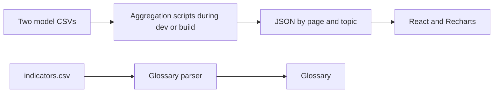

# Data and calculations

[Back to README](../README.md)

## 1. Data sources

All data used by Dashboard is located in `src/data/`.

| File | Purpose |
| --- | --- |
| `indicators.csv` | Vietnamese and English glossary names and definitions |
| `STAR_FARM CSV - Master file.csv` | Model data with monetary values in USD |
| `STAR_FARM CSV - Dữ liệu tổng.csv` | Corresponding source with monetary values in VND |
| `catalog.json` | Metadata describing the source CSVs; not regenerated by the two aggregation scripts |

At the time of writing, each model CSV contains **19,404 records**: **420 baseline records for 2016–2022** and **18,984 future records for 2027–2050**. Master has 30 columns and the VND source has 29. There are 16 future scenarios; overview tables add current conditions as a seventeenth row. The future series covers 24 years.

These counts describe the current dataset. Check them again when replacing the data rather than treating them as permanent requirements for every future dataset.

The two CSVs are corresponding representations of the data. **Do not combine them** to count observations or calculate averages. Vietnamese names and VND amounts come from the VND source, while USD amounts come from Master. Aggregators cross-check scenario combinations, record counts, and relevant indicators between the sources.

## 2. Data flow



For data pages, the browser uses pre-aggregated JSON instead of downloading and parsing both full model CSVs to render charts. The smaller glossary CSV is imported as text using `?raw` and parsed in the application.

### Generated files

| Command | Files in `src/data/` |
| --- | --- |
| `npm run data:future` | `future-series.json` |
| `npm run data:scenarios` | `scenario-details.json`, `economics-overview.json`, `economics-comparison.json` |
| Same `data:scenarios` command | `economics-bau3-series.json`, `economics-bau2-series.json`, `economics-bauss-series.json` |
| Same `data:scenarios` command | `resources.json`, `environment.json` |

Do not edit these JSON files directly to update values: the next script run overwrites them. Update the source CSVs or aggregation logic, then regenerate the JSON.

## 3. Glossary CSV

`readIndicators` in `src/features/glossary/glossaryData.ts` requires the following columns. Keep the original column names, including Vietnamese headers.

| Column | Contents |
| --- | --- |
| `id` | A unique, nonempty identifier |
| `Name` | English name |
| `Definition` | English definition |
| `Tên kịch bản` | Vietnamese name; the header is retained from the source schema |
| `Phân loại` | A supported category |
| `Định nghĩa` | Vietnamese definition |

Supported category values are currently `Kinh tế` (Economics), `Khí hậu` (Climate), `Phát thải` (Emissions), `Canh tác` (Farming), and `Kịch bản` (Scenarios). These are data values: replacing `Khí hậu` with `Thời tiết` in the category column requires changes to the parser and related labels, not just the CSV.

Keep UTF-8 encoding and valid CSV quoting. Values containing commas or line breaks must be quoted, and embedded quotation marks must be escaped according to CSV rules. Rows with missing names/definitions, incorrect column counts, or duplicate IDs are rejected.

Edit this file to change glossary names and definitions. KPI, menu, and chart labels are stored in separate translation files and do not automatically change with the glossary CSV.

## 4. Calculation rules

Aggregators validate required columns, dates, and categories. Some source spellings, such as `Serve Climate`, are normalized for display. Do not rename source headers or category values without checking the corresponding mappings.

- Empty cells represent missing data and are stored as `null` where supported by the aggregator.
- Preserve valid zero and negative values.
- Calculate averages from valid observations for each indicator; do not replace missing data with zero.
- When combining groups or years with different record counts, retain the observation weights used by the relevant aggregator. Do not assume an unweighted average of previously averaged values is equivalent.
- Per-hectare values are averages of cultivation records; do not automatically sum seasons into annual totals.
- Line charts do not interpolate across missing observations.

### Scope by page

| Page | Main values | Comparison baseline or reference |
| --- | --- | --- |
| About the future | Average observations for each year in the selected range | Groups and trends within that range |
| Scenario details | Scenario averages for 2027–2050 | Current-condition averages for 2016–2022 |
| Overview > Information dashboard | Scenario averages, with current conditions as a separate row | The period shown for each row |
| Overview > Comparison dashboard | Group averages under selected filters for 2027–2050 | BAU versus 1Mha |
| BAU3S/BAU2S/BAUSS versus 1Mha | Annual series for four condition combinations | Both systems under matching conditions in the same year |
| Individual farming systems | Average KPIs and annual series for the system | Change from 2027 to 2050 |

Do not interpret a multi-year average as an individual 2050 result. Dashboard does not substitute the Web App's 2050-versus-2022 comparison for the baselines above.

### Relative changes and percentage points

For a nonzero baseline, Scenario details uses:

```text
Relative change (%) = (scenario value - baseline) / abs(baseline) × 100
```

A zero or missing baseline does not yield a valid relative percentage; the interface displays an unavailable state instead of inventing a result.

A relative change in an indicator measured in `%` is different from a **percentage-point difference**. For example, a decrease from 40% to 30% is a decrease of 10 percentage points, or a relative decrease of 25%.

Individual economic farming-system pages express the profit-margin change from 2027 to 2050 in percentage points. Changes in the AWD adoption rate also use percentage points. Vietnamese labels use **điểm %**; English labels use **pp**. Read the unit attached to each comparison.

### ROI and profit margin

ROI is defined as `Net Income / Production Cost × 100%`. Do not replace net income with revenue in this formula.

Two aggregation methods currently coexist:

- **Scenario details:** calculate ROI for each record with positive production costs, then average those ratios.
- **Economic information dashboard:** divide mean income by mean production cost, then multiply by 100%.

The results can differ. `Profit Margin` uses the source field and must not be replaced with ROI. Before changing or unifying these methods, review `aggregateScenarios.ts`, `economicsData.ts`, and their tests.

## 5. Units

| Indicator | Vietnamese interface | English interface |
| --- | --- | --- |
| Monetary values | VNĐ/ha | USD/ha |
| Yield | tấn/ha | ton/ha |
| Labor | giờ/ha | hours/ha |
| Water | mm | mm |
| Nitrogen fertilizer | kg Nito/ha | kg Nitrogen/ha |
| Pesticide use | lần | applications |
| Methane emissions | kg Metan/ha | kg Methane/ha |
| Emission intensity on Environment pages | kg Metan/tấn gạo | kg Methane/ton rice |
| Emission intensity in Scenario details | kg Metan/kg gạo | kg Methane/kg rice |

Water is expressed as depth in millimeters. Do not relabel it as m³/ha without converting the values. Pesticide use in Dashboard is the number of applications, not kg/ha.

Source emission intensity is measured in kg Methane/kg rice. The Environment aggregator multiplies it by **1,000** to express it per ton of rice; Scenario details retains the per-kilogram unit. This difference is intentional. Do not multiply by 1,000 again in an Environment component after the JSON has already been converted.

## Currency and exchange rates

Dashboard currently **does not fetch daily exchange rates**. Switching languages selects the corresponding VND or USD monetary data; components do not multiply values by a fixed exchange rate.

A shared daily exchange-rate mechanism for Dashboard and Web App has been proposed but is not implemented in Dashboard. Implementation would require selecting a source, defining refresh timing and fallback behavior, and consistently converting monetary fields from one source currency. Changing a rate label or a single CSV value would not update the entire site correctly.

Online conversion also requires a decision about the treatment of historical and projected values. Display the rate date, retain the original data, and calculate ratios consistently from the original values. This would be a functional change requiring validation across pages and analyses that currently use two monetary sources.

## 6. Updating data

1. Retain the previous source files for comparison and rollback.
2. Edit the appropriate CSV while preserving UTF-8 encoding, headers, and identifiers.
3. When replacing model data, update both corresponding sources and `catalog.json` metadata as needed.
4. Run `npm run data:future` and `npm run data:scenarios`.
5. Run tests, lint, and build as described in [Build and deployment](BUILD_VA_TRIEN_KHAI.md).
6. Spot-check scenarios and years in both languages before publishing the complete `dist/` directory.

Editing a CSV locally does not automatically update the deployed website. Rebuild and deploy a new release.
